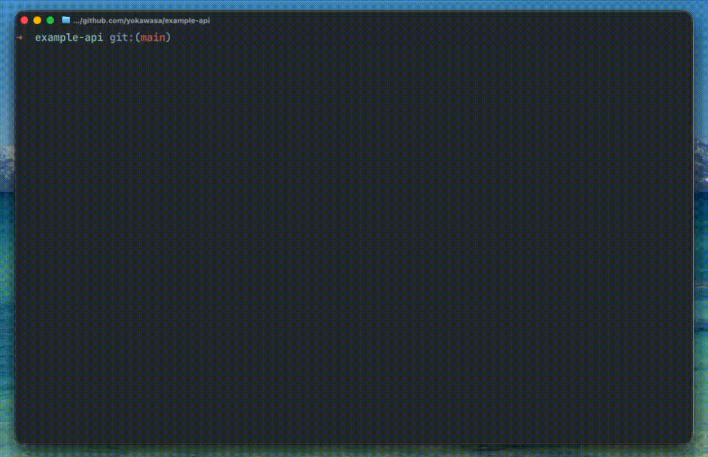

# postman-cli-completion

Shell completion scripts for the [Postman CLI](https://learning.postman.com/docs/postman-cli/postman-cli-overview/) (`postman`) on **zsh**, **bash**, and **fish**.

Completes:

- All top-level commands (`login`, `collection`, `spec`, `monitor`, `workspace`, `flows`, etc.) and their subcommands.
- Flags for each (sub)command.
- Local file arguments such as `*.json` (collections, manifests) and `*.yaml`/`*.yml` (specs, simulate scenarios).

Dynamic completion of remote IDs (collection / workspace / monitor IDs) is **not** supported — paste those yourself.



## Install

### Via npm (recommended)

```sh
npm install -g postman-cli-completion
```

This installs a `postman-completion` helper command — it does **not** shadow the real
`postman` CLI (install that separately via `npm i -g postman-cli`). The helper prints the
completion script for your shell to stdout; wire it in as follows.

**zsh** — quick test in the current shell (requires `compinit` already initialised, see
the note below):

```sh
source <(postman-completion zsh)
```

**zsh** — persistent. Add the packaged completions dir to `fpath` in `~/.zshrc`:

```sh
fpath=("$(postman-completion path zsh --dir)" $fpath)
autoload -Uz compinit && compinit
```

**bash** — add to `~/.bashrc` (requires bash 4+; see the bash note below):

```sh
source <(postman-completion bash)
```

**fish** — source it in the current session, or install it persistently:

```sh
postman-completion fish | source
# persistent:
ln -sf "$(postman-completion path fish)" ~/.config/fish/completions/postman.fish
```

### From source

Clone this repo somewhere, e.g. `~/.postman-cli-completion`:

```sh
git clone https://github.com/yokawasa/postman-cli-completion.git ~/.postman-cli-completion
```

### zsh

Add the completions directory to `fpath` and rerun `compinit`. Put this in `~/.zshrc`:

```sh
fpath=(~/.postman-cli-completion/completions/zsh $fpath)
autoload -Uz compinit && compinit
```

Or, for a quick test in the current shell:

```sh
source ~/.postman-cli-completion/completions/zsh/_postman
```

> **Note:** `compinit` must already be initialised in your shell for `source` to register the completion. Most zsh setups (oh-my-zsh, prezto, or a plain `.zshrc` that runs `autoload -Uz compinit && compinit`) do this automatically. If `postman <TAB>` still does nothing after sourcing, run `autoload -Uz compinit && compinit` first and try again.

### bash

Add to `~/.bashrc` (or `~/.bash_profile` on macOS):

```sh
source ~/.postman-cli-completion/completions/bash/postman.bash
```

Requires bash 4+ (`shopt -s extglob`). On macOS the system bash is 3.2 — install a newer bash via Homebrew (`brew install bash`) if needed.

### fish

Copy or symlink into fish's completion directory:

```sh
ln -s ~/.postman-cli-completion/completions/fish/postman.fish \
      ~/.config/fish/completions/postman.fish
```

Or source it in the current session:

```sh
source ~/.postman-cli-completion/completions/fish/postman.fish
```

## Verify (manual checklist)

After installing for your shell, open a fresh terminal and check each:

| Input | Expected |
| --- | --- |
| `postman <TAB>` | All top-level commands appear |
| `postman col<TAB>` | Completes to `collection` |
| `postman collection <TAB>` | `migrate`, `lint`, `run` |
| `postman collection run <TAB>` | `*.json` files in the current directory |
| `postman collection run --<TAB>` | Flag list (`--environment`, `--iteration-data`, `--reporters`, …) |
| `postman collection run -r <TAB>` | `cli`, `json`, `junit`, `html` |
| `postman request <TAB>` | `GET`, `POST`, `PUT`, `DELETE`, `PATCH`, `HEAD`, `OPTIONS` |
| `postman spec lint <TAB>` | `*.yaml` / `*.yml` / `*.json` files |
| `postman flows <TAB>` | `list`, `trigger`, `deploy`, `run`, `update`, `list-runs`, `get-run` |
| `postman --<TAB>` | `--silent`, `--color`, `--version`, `--help` |

## Check your Postman CLI version

The completions are generated for a specific Postman CLI version, so a CLI that has
drifted from that version may complete commands it does not have (or miss ones it does).
`doctor` reports both kinds of drift:

```sh
postman-completion doctor
```

It performs two independent checks:

1. **Installed CLI vs. the latest published `postman-cli`** — if yours is older, it warns
   and tells you how to upgrade.
2. **Installed CLI vs. the version these completions were generated for** — if they differ,
   it warns and tells you how to update the completions.

```console
$ postman-completion doctor
Your Postman CLI is outdated: installed 1.60.0, latest 1.73.0.
  Upgrade with: npm install -g postman-cli@latest
These completions were generated for Postman CLI 1.73.0, but 1.60.0 is installed.
  Completions may offer commands your CLI does not have.
  Update them with: npm install -g postman-cli-completion@latest
```

Check 1 queries the npm registry. To skip it — offline, or in a hook where you do not want
a network call — use `--offline`, which still runs check 2:

```sh
postman-completion doctor --offline
```

`doctor` exits **1** when you should act (outdated CLI, or completions that no longer match
it) and **0** when everything is current, so it works as a shell-startup or CI check. A
missing Postman CLI is reported as a notice and exits 0. A failed registry lookup never
fails the command — it degrades to the offline check and explains itself on stderr.

## Versioning

The completion scripts are auto-generated from a single source of truth (`spec/commands.json`) and tracked against the upstream Postman CLI by two GitHub Actions workflows:

- **`catchup.yml`** runs daily, queries npm for the latest `postman-cli` version, introspects its `--help` surface, regenerates the spec and the three completion scripts, and opens an auto-merging PR whenever something changed.
- **`release.yml`** fires when `spec/commands.json` lands on `main` and publishes a matching GitHub Release (e.g. tag `v1.39.0` mirrors Postman CLI 1.39.0).

So this repo follows the latest published Postman CLI version automatically — pull the latest `main` (or grab the matching tag) and the completions will match whatever Postman CLI version you have installed.

Suspicious catchup diffs (≥30 % flag drop, a known fixed command missing, semver regression) are blocked by `scripts/validate-diff.mjs` and stay open for human review instead of auto-merging.

To compare the version the completions were built for against your installed CLI, use
[`postman-completion doctor`](#check-your-postman-cli-version). The underlying values are:

```sh
node -p "require('./spec/commands.json').postmanCliVersion"   # what the completions target
postman --version                                             # what you have installed
```

## License

[MIT](./LICENSE) — see the LICENSE file.
